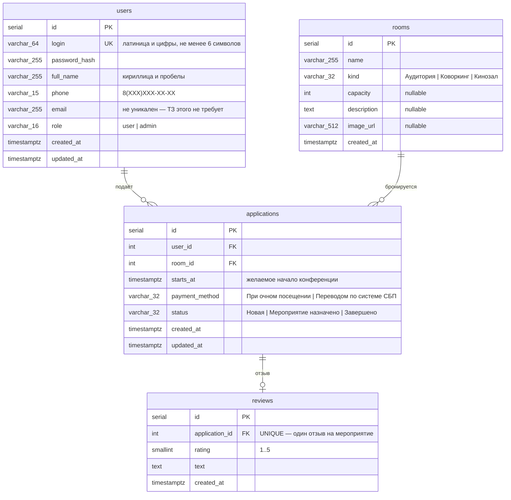

# Схема данных «Конференции.РФ»

Источник истины — сущности TypeORM в `apps/backend/src/*/*.entity.ts` и миграции в
`apps/backend/src/database/migrations/`. Обоснование решений по полям — в
[ADR-0003](../adr/0003-orm-and-data-model.md).

## Ограничения уровня базы

| Ограничение                         | Что проверяет                                      |
| ----------------------------------- | -------------------------------------------------- |
| `users_login_unique`                | уникальность логина (требование ТЗ)                |
| `users_role_check`                  | `role IN ('user', 'admin')`                        |
| `rooms_kind_check`                  | `kind` — только три типа помещений из ТЗ           |
| `applications_status_check`         | `status` — только три статуса из ТЗ                |
| `applications_payment_method_check` | `payment_method` — только два способа оплаты из ТЗ |
| `reviews_rating_check`              | `rating BETWEEN 1 AND 5`                           |
| `reviews.application_id` UNIQUE     | один отзыв на одну заявку                          |

Значения во всех `CHECK` генерируются из констант `@kim/shared`, поэтому база и код не
могут разойтись.

## Поведение при удалении

- Удаление пользователя → его заявки удаляются (`ON DELETE CASCADE`).
- Удаление заявки → её отзыв удаляется (`ON DELETE CASCADE`).
- Удаление помещения запрещено, пока на него есть заявки (`ON DELETE RESTRICT`).

## Индексы

`applications.user_id`, `applications.room_id`, `applications.status` — под запросы
«мои заявки», фильтрацию в панели администратора (Задание 2, п. 5) и выборку по
помещению.
